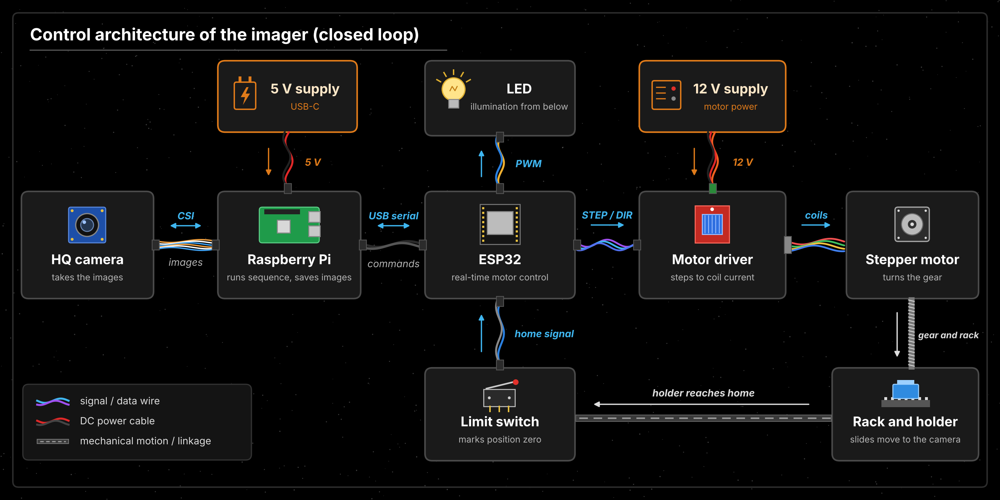
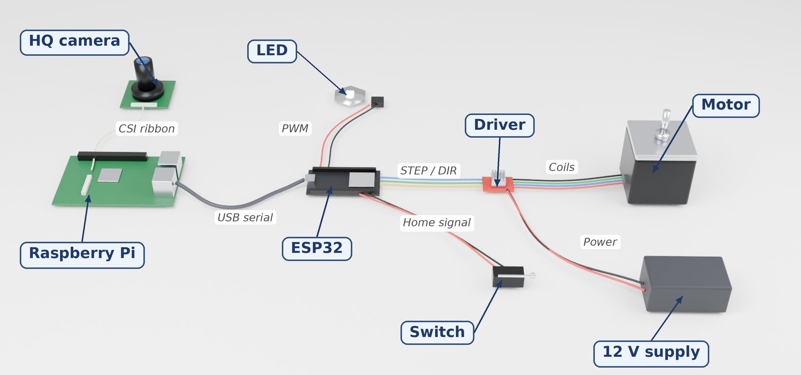

# Week 2: Requirements Spec v1 and Control Architecture

**Project:** SWIFT: A Low-Cost Standardised Imaging System for AI-Based Mosquito Wing Classification
**Course:** Frugal Photonics for Global Health, WS 2026/27, Friedrich Schiller University Jena
**Author:** Kizito Nmesomachukwu Odizilike
**Project contribution:** control and acquisition software (ESP32, Raspberry Pi, automation, timing)

The BNITM wing classifier sees each wing as a 300 × 300 pixel image [1]. This week works
backwards from that input to the optical performance an imager must deliver: field of view,
magnification, minimum numerical aperture (NA), contrast and a resolution test target. It then
checks whether the Raspberry Pi HQ camera meets the requirement, and sets out the control
architecture that will move the slides and take the images.

**Result:** at the wing, the optics must resolve about 90 lp/mm, which needs only NA ≥ 0.060.
The Pi HQ camera samples about 4.9× finer than that. Resolution is therefore not the
bottleneck; standardised illumination and acquisition are. These values are for a single wing;
following mentor feedback, the field of view for all wings of one slide (about 8) is now
handled by the camera and objective sub-team.

## Motivation

CNN mosquito classifiers, trained on wing or body images, lose about 14% mean accuracy on
images from a device not included in training, even with extensive augmentation [1]. A large
public repository of 18,104 wing images was captured without standardised settings, with
exposure and lighting varying between projects [2]. A low-cost imager with fixed, reproducible
acquisition addresses both problems. Before choosing hardware, this week defines how good its
optics need to be.

## Physics Background

### (i) What the Classifier Sees: Sampling

The wing is cropped, padded to a square and resized to N = 300 pixels [1]. For a square crop of
physical width S, one CNN pixel covers

```math
\delta = \frac{S}{N}
```

of the wing. The tightest crop has S equal to the wing length L, which is the worst case used
here. By the Nyquist-Shannon sampling theorem [9], a grid with spacing δ represents spatial
frequencies up to

```math
f_N = \frac{1}{2\delta} = \frac{150}{L}\ \text{lp/mm} \qquad (L \text{ in mm})
```

because one line pair (a bright and a dark bar) needs at least two pixels. Detail finer than
$f_N$ cannot be represented after the resize, so the optics need not deliver more than $f_N$,
but must deliver this much. Since $f_N$ falls as 1/L, the smallest wing is the worst case.

### (ii) Lens Resolution: Rayleigh Criterion

A lens with a round aperture images a point as an Airy pattern whose first dark ring lies at
$r_R = 0.61\,\lambda/\mathrm{NA}$, measured at the object [5]. Two points are just resolved
when one lies on the other's first dark ring (Rayleigh criterion). The design rule used here
is that two points one CNN pixel apart must be resolved, $r_R \le \delta$, which gives

```math
\mathrm{NA}_{\min} = \frac{0.61\,\lambda}{\delta}
```

with $\mathrm{NA} = n \sin\theta$, where θ is the half-angle of the light cone accepted by the
lens. In air (n = 1) the flat cover slip does not change NA, since Snell's law conserves
$n\sin\theta$ across plane interfaces.

### (iii) Contrast: Modulation Transfer Function

For incoherent illumination, a diffraction-limited lens with a round aperture passes no
contrast above the cutoff frequency [6]

```math
f_c = \frac{2\,\mathrm{NA}}{\lambda}
```

and below it keeps the fraction of contrast [6]

```math
\mathrm{MTF}(\nu) = \frac{2}{\pi}\left[\arccos\nu - \nu\sqrt{1-\nu^{2}}\right],
\qquad \nu = \frac{f}{f_c},\quad 0 \le \nu \le 1 .
```

With NA chosen by the rule in (ii), the classifier limit sits at

```math
\nu = \frac{f_N}{f_c} = \frac{\lambda}{4\,\delta\,\mathrm{NA}} = \frac{1}{4 \times 0.61} = 0.41 ,
```

independent of wing length and wavelength, so a perfect lens at $\mathrm{NA}_{\min}$ keeps
MTF = 0.49 at $f_N$. Contrast at $f_N$ reaches zero when $f_c = f_N$, that is at
$\mathrm{NA} = \lambda f_N / 2$, the absolute lower limit.

### (iv) Depth of Field

The depth of field is the sum of a wave-optical and a geometrical term [7],
$d = \lambda n/\mathrm{NA}^2 + n\,e/(M\,\mathrm{NA})$, where e is the smallest distance the
detector resolves and M the lateral magnification. The script reports the wave term only.
Taking e as one Pi HQ pixel (1.55 µm) at M = 1.37 and NA = 0.060, the geometrical term is
about 19 µm against 151 µm for the wave term.

### (v) Camera Sampling

The magnification maps the field of view onto the sensor width W, $m = W/\mathrm{FOV}$. One
sensor pixel of pitch p then covers $p_{\text{obj}} = p/m$ of the wing, and the camera's own
Nyquist limit at the wing is $f_{\text{cam}} = 1/(2\,p_{\text{obj}})$.

### (vi) Test Target

Element E of group G of the USAF 1951 resolution target [8] has spatial frequency

```math
f = 2^{\,G + (E-1)/6}\ \text{lp/mm}.
```

The script selects the coarsest element at or above $f_N$, which gives an objective
pass/fail test for a prototype.

## Assumptions

| | Assumption | Value | Basis |
|---|---|---|---|
| A1 | Wing long axis fills the 300 px CNN frame (S = L) | N = 300 | [1] |
| A2 | Wing-length range | 1.67 to 3.83 mm | *Ae. aegypti* females [3] |
| A3 | Design wavelength (white LED, middle of spectrum) | λ = 0.55 µm | design choice |
| A4 | Field-of-view margin for wing placement | 20% | design choice |
| A5 | Diffraction-limited lens, incoherent brightfield illumination | | best case [6] |
| A6 | Air between cover slip and lens | n = 1 | dry lens |

The wing-length range is that of *Ae. aegypti* [3]; other genera are outside this version of
the spec.

## Requirements (Spec v1)

| Quantity | Value | Derivation |
|---|---|---|
| Field of view (long axis) | 4.6 mm | 3.83 mm × 1.2 |
| Magnification (Pi HQ, W = 6.287 mm) | 1.37× | W / FOV |
| Camera pixel at the wing (p = 1.55 µm) | 1.13 µm | p / m |
| CNN pixel at the wing, 3.83 mm / 1.67 mm wing | 12.8 / 5.57 µm | L / 300 [1] |
| CNN Nyquist, 3.83 mm / 1.67 mm wing | 39.2 / 89.8 lp/mm | 1 / (2δ) [9] |
| Minimum NA (Rayleigh rule) | 0.060 (θ = 3.5°) | 0.61 λ / δ [5] |
| Lens cutoff at minimum NA | 219 lp/mm | 2 NA / λ [6] |
| Contrast (MTF) at 89.8 lp/mm | 0.49 | diffraction MTF [6] |
| NA at which that contrast reaches zero | 0.025 | λ f_N / 2 [6] |
| Depth of field at minimum NA (wave term) | 151 µm | λ / NA² [7] |
| USAF 1951 test element | Group 6, Element 4: 90.5 lp/mm | [8] |
| Pi HQ Nyquist at the wing | 441 lp/mm | 1 / (2 p_obj) [9] |
| Camera headroom over requirement | 4.9× | 441 / 89.8 |

**Design requirements carried forward:**

1. Field of view of at least 4.6 mm along the wing axis.
2. Resolve USAF Group 6, Element 4 (90.5 lp/mm) at the wing.
3. NA of at least 0.060, chosen above that value for margin against aberrations and defocus.
4. Fixed exposure, gain, white balance and illumination, since device and setting variation is
   the documented failure mode [1, 2].


The curve is the requirement $f_N = 150/L$; the grey band is the *Ae. aegypti* range [3].
Even the smallest wing stays well below the Pi HQ sampling limit.

## Control Architecture

The Raspberry Pi runs the imaging sequence and saves the images; the ESP32 handles the
time-critical motor control. They talk over one USB cable, which also powers the ESP32.



| Part | Job | Connection |
|---|---|---|
| Raspberry Pi | runs the sequence, triggers the camera, saves images | USB serial to ESP32, CSI to camera |
| HQ camera | takes the images | CSI ribbon |
| ESP32 | counts motor steps, switches the LED, reads the switch | STEP / DIR, PWM, home signal |
| Motor driver | turns step pulses into coil currents | coils to motor, 12 V supply |
| Stepper motor | turns the gear that drives the rack and slide holder | |
| Limit switch | marks position zero of the holder | home signal to ESP32 |
| LED | illumination from below | PWM from ESP32 |

The loop is closed mechanically: the motor moves the holder until it presses the limit switch,
which gives the ESP32 a fixed zero from which every slide position is counted in steps.

**Serial commands (draft):** `HOME` (move to the switch, set zero), `MOVE n` (n steps),
`NEXT` (next slide under the camera), `LED ON` / `LED OFF`, `STATUS` (position and switch
state). Each command is answered with `OK` or an error message.



## Validation

- The handwritten calculation (PDF) reproduces δ, $f_N$, NA, $f_c$, the MTF and the camera headroom from the formulas in (i), (ii), (iii) and (v).
- The MTF expression returns 1 at ν = 0 and 0 at ν = 1, as required by its definition.
- The USAF formula is checked against two known elements: G6E4 = 90.5 lp/mm and
  G5E3 = 40.3 lp/mm.
- The Pi HQ sensor values (4056 × 3040 pixels, 1.55 µm pitch, 6.287 × 4.712 mm image area)
  match the manufacturer's documentation [4].

## Repository Structure

```
week02_requirements_spec/
├── w1_requirements_spec.py          # requirement calculation, table and plot
├── w1_required_resolution.png       # output plot
├── control_2d.py                    # 2D control diagram (matplotlib)
├── control_scene.py                 # 3D render of the control hardware (Blender)
├── label_ctrl.py                    # labels for the 3D render
├── control_architecture_2d.png
├── control_architecture_3d.png
├── w2_hand_calculation.pdf
│ 
├── requirements.txt
└── README.md
```

## Installation

```bash
pip install -r requirements.txt
```

`bpy` (Blender as a Python module) needs Python 3.13 and is only used for the 3D render.

## Usage

Requirement calculation (prints the table above and saves `w1_required_resolution.png`):

```bash
python3 w1_requirements_spec.py
```

Control diagrams, run in this order (the 3D render takes a few minutes on a CPU):

```bash
python control_scene.py render.png 1800 1100 32
python label_ctrl.py render.png control_architecture_3d.png
python control_2d.py
```

On Google Colab, upload the scripts and run everything in one cell:

```bash
%%bash
pip install -q -r requirements.txt
apt-get -qq install -y libsm6 libxi6 libxkbcommon0 libxrender1 libxxf86vm1 libgl1 > /dev/null
python w1_requirements_spec.py
python control_scene.py render.png 1800 1100 32
python label_ctrl.py render.png control_architecture_3d.png
python control_2d.py
```

## Citation Policy

Every formula in the script carries a bracketed reference at the point of use, and every
design choice is marked ASSUMPTION. Numbering is the same in the script and this README.

## References

1. K. Nolte, F. G. Sauer, J. Baumbach, P. Kollmannsberger, C. Lins, R. Lühken, Robust mosquito
   species identification from diverse body and wing images using deep learning,
   *Parasites & Vectors* 17, 372 (2024). doi:10.1186/s13071-024-06459-3
2. K. Nolte, E. Agboli, et al., Comprehensive mosquito wing image repository for advancing
   research on geometric morphometric- and AI-based identification, *Scientific Data* 12, 715
   (2025). doi:10.1038/s41597-025-05043-3
3. J. R. Schneider, A. C. Morrison, H. Astete, T. W. Scott, M. L. Wilson, Adult size and
   distribution of *Aedes aegypti* (Diptera: Culicidae) associated with larval habitats in
   Iquitos, Peru, *J. Med. Entomol.* 41(4), 634-642 (2004). doi:10.1603/0022-2585-41.4.634
4. Raspberry Pi Ltd., Camera hardware documentation, HQ Camera (Sony IMX477) specifications.
   https://www.raspberrypi.com/documentation/accessories/camera.html
5. E. Hecht, *Optics*, 5th ed., Pearson (2017).
6. J. W. Goodman, *Introduction to Fourier Optics*, 3rd ed., Roberts & Company (2005).
7. S. Inoué, K. R. Spring, *Video Microscopy: The Fundamentals*, 2nd ed., Plenum Press,
   New York (1997).
8. MIL-STD-150A, *Photographic Lenses*, US Department of Defense (1959).
9. C. E. Shannon, Communication in the presence of noise, *Proc. IRE* 37(1), 10-21 (1949).
